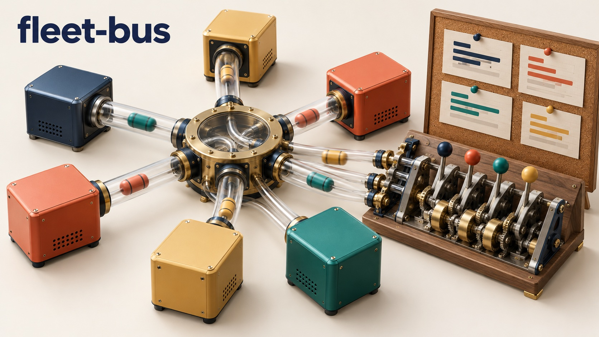
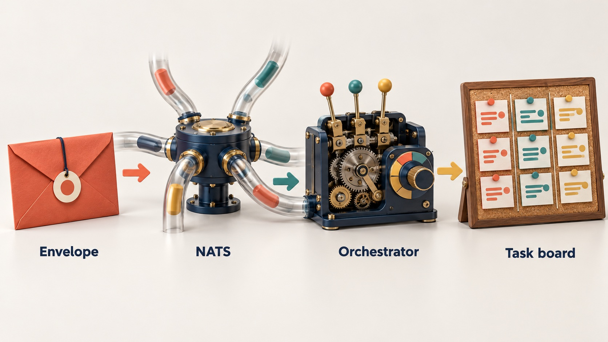
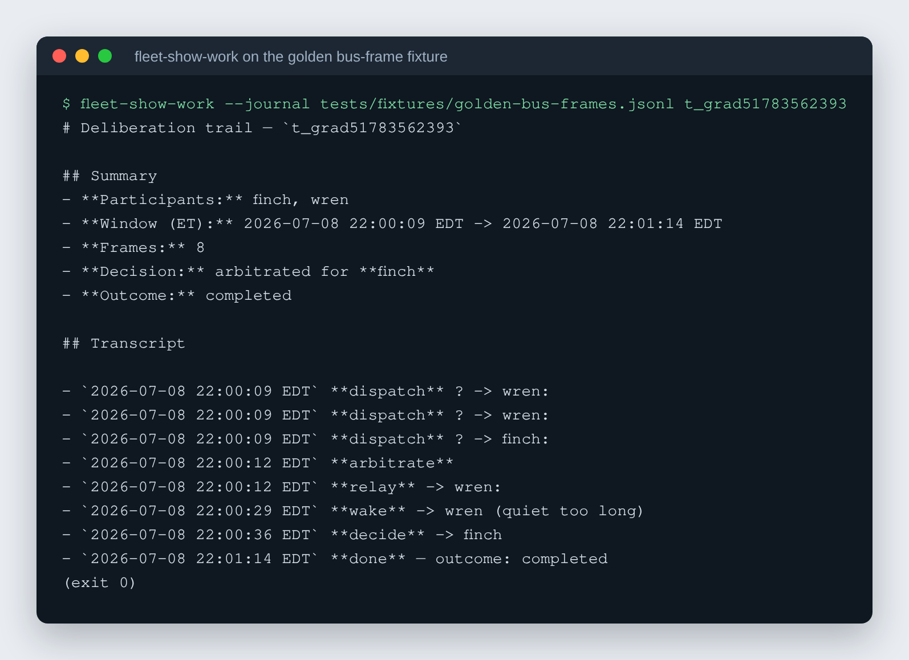

# fleet-bus

A NATS coordination bus for a small fleet of long-running AI agents, with a deterministic orchestrator that decides who works on what.

[](https://github.com/rodaddy/fleet-bus/actions/workflows/ci.yml)
[](LICENSE)




## What it is

fleet-bus is the coordination layer for a handful of AI agents that work
together on tasks. People read and steer the work in a chat channel. The agents
hand work to each other over NATS with typed messages. A small state machine,
written as ordinary code, decides who goes next, and an external task board
keeps the record of every task. In plain terms: the agents keep talking where
people can see them, but the hand-offs between them stop depending on an agent
noticing a chat message.

Its sibling repo, [rtech-agents](https://github.com/rodaddy/rtech-agents), is
the agent runtime that rides on it: per-agent daemons, typed frames, chat
edges. fleet-bus works without rtech-agents; rtech-agents needs fleet-bus.

## Why it exists

Agents that coordinate by talking to each other in a chat channel go wrong in
predictable ways: they miss mentions, answer twice, lose hand-offs, and nobody
can say afterwards who owned a task. fleet-bus moves the coordination off the
chat surface and into code, so the people overseeing the agents can trust who
is doing what and can pause, resume or re-budget a task with one control
message.

## How it works



The system has four planes, each with one job. Chat (Discord) is the human
display: agents post their own words there, and nothing decides control flow by
reading chat. NATS is the control plane: dispatch, relay, wake and control
messages ride a typed `Envelope` on a fixed subject tree
(`{env}.{domain}.{...}`), built only through `fleet_nats.subjects`. The
orchestrator (`fleet_orchestrator.transitions`) is a pure `next_action(state,
event)` function with no model, clock or I/O, so every transition is a case in
code with a unit test. The k-board, an external task board reached over its
REST API, holds task state with compare-and-set updates; the orchestrator
writes there first and then emits the bus signal. On each agent host,
`fleet-subscriber` turns an inbound envelope into a real agent turn on a
Hermes-style gateway. The full trace from a human post to a finished task is in
[docs/architecture.md](docs/architecture.md).



*Real output: `fleet-show-work` rebuilding one task's dispatch, arbitration,
relay, wake and completion from the bus-frame fixture in
`packages/fleet-nats/tests/fixtures/golden-bus-frames.jsonl`.*

## Features

- Typed message envelope with versioning, redaction and a compatibility policy
  ([docs/contracts/](docs/contracts/)).
- Subject builders for dispatch, relay, wake, inbox, heartbeat, token cost and
  control lanes, so no consumer hand-writes a subject string.
- Deterministic orchestrator: task state machine, dispatch, relay, wake and
  retry behaviours, a relay governor with message budgets, and a kill switch.
- Control frames to pause, resume or add budget to a task from any harness.
- `fleet-show-work`: rebuild one task's deliberation trail from the hub's frame journal.
- Liveness and heartbeat tracking per agent, plus per-turn token-cost
  envelopes.
- k-board compare-and-set client and an intake poller.
- JetStream-backed durable delivery for coordination traffic, with tests that
  run against a real `nats-server`.
- Example per-agent NATS authorization config and a provisioning script.
- CI gates on `ruff check`, `ruff format --check`, `mypy --strict` and `pytest`
  for every package.

## Packages

| Package | What it does |
|---|---|
| `packages/fleet-core` | Base client: typed config, logging, transport boundary, a prod/staging URL tripwire. |
| `packages/fleet-nats` | The shared NATS library: connection, typed envelope, subject builders, pub/sub/request-reply, redaction, channel map. |
| `packages/fleet-orchestrator` | The deterministic coordination logic: task state machine, behaviours (dispatch, relay, wake, retry), k-board client, intake poller, tracing. |
| `packages/fleet-subscriber` | Per-agent subscriber plugin that turns an inbound envelope into an agent turn. |

## Quick start

Requires Python 3.13+ and [uv](https://docs.astral.sh/uv/). `nats-server` on
PATH lets the JetStream tests run instead of skipping.

```bash
git clone https://github.com/rodaddy/fleet-bus.git
cd fleet-bus
uv sync --all-packages --all-extras
cd packages/fleet-nats
../../.venv/bin/ruff check src/ tests/
../../.venv/bin/mypy src/ tests/
../../.venv/bin/pytest tests/ -q
```

Repeat the last three commands in each package, or read
[.github/workflows/ci.yml](.github/workflows/ci.yml), which gates all four.
Point a consumer at your own server with `FLEET_NATS_URL` (the default,
`nats://192.0.2.74:4222`, is a documentation address).

```python
from fleet_nats import BusConfig, Envelope, FleetBus, subjects

async with FleetBus(BusConfig.from_env("manager")) as bus:
    await bus.publish(
        subjects.agent_dispatch("dev", "worker-1", channel="all-agents"),
        Envelope.new(msg_id=..., ts=..., sender="manager", kind="dispatch",
                     payload={"task": "..."}),
    )
```

Unit tests run anywhere. Tests named `*_live.py` need a reachable NATS server
and real agents and skip themselves otherwise. The shell tests in
`tests/*.test.sh` exercise the deploy scripts against local fixtures.

## How it was built

fleet-bus was built in July 2026 in planned goal runs: a written master plan,
executable checkers for each plan item, AI agents writing code in parallel
lanes, and review by a second model family before merge. The build story
covers the timeline, the six written contracts, the design decisions, how the
system is tested, and what had to change after it ran:
[docs/BUILD-STORY.md](docs/BUILD-STORY.md).

## Project status

Experimental. The author ran this code for a three-agent fleet on a private
network in 2026; no other deployment has been run, and that deployment cannot
be reproduced from this repo alone. The repo does not contain the k-board
service, an agent runtime, or any agent personas. Hostnames, agent names and
the chat channel map are configuration you supply.

- The deploy scripts and `.github/workflows/deploy*.yml` are the author's own
  hub deploy: a single hub host reached over SSH from a self-hosted runner.
  Read them as a worked example, not as something to run unchanged.
- Docs and tests use the example agent ids `wren`, `finch` and `heron`. The
  production NATS config in `deploy/nats/` and its provisioning script keep
  the author's own agent ids, because the deploy workflow ships that file to a
  live hub.
- "Dash" in the docs and tests is a neutral stand-in for a sibling TypeScript
  platform that shares the same subject convention.
- Hostnames under `example.internal` and addresses in `192.0.2.0/24` are
  placeholders.

## Docs

- [docs/architecture.md](docs/architecture.md): the whole system, traced from a human post to a finished task.
- [docs/consumers.md](docs/consumers.md): how a consumer imports `fleet-nats` as a thin adapter.
- [docs/contracts/](docs/contracts/): envelope, ordering, retry and QoS contracts.
- [docs/runbook.md](docs/runbook.md): deploy, verify, roll back, troubleshoot.
- [docs/logging.md](docs/logging.md): the sanitized logging convention.

## Licence

MIT. See [LICENSE](LICENSE).

## Credits

- [NATS](https://nats.io) and [nats.py](https://github.com/nats-io/nats.py)
- [uv](https://docs.astral.sh/uv/), [ruff](https://docs.astral.sh/ruff/) and [mypy](https://mypy-lang.org)

## Author

Rico Rojas, https://rico-rojas.com
